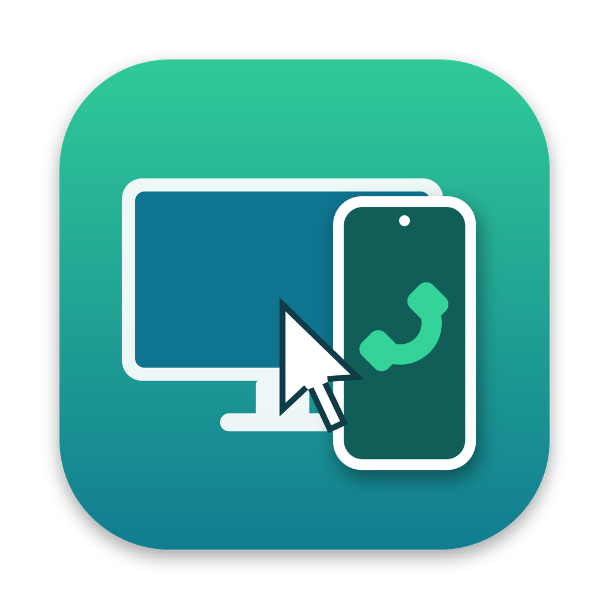
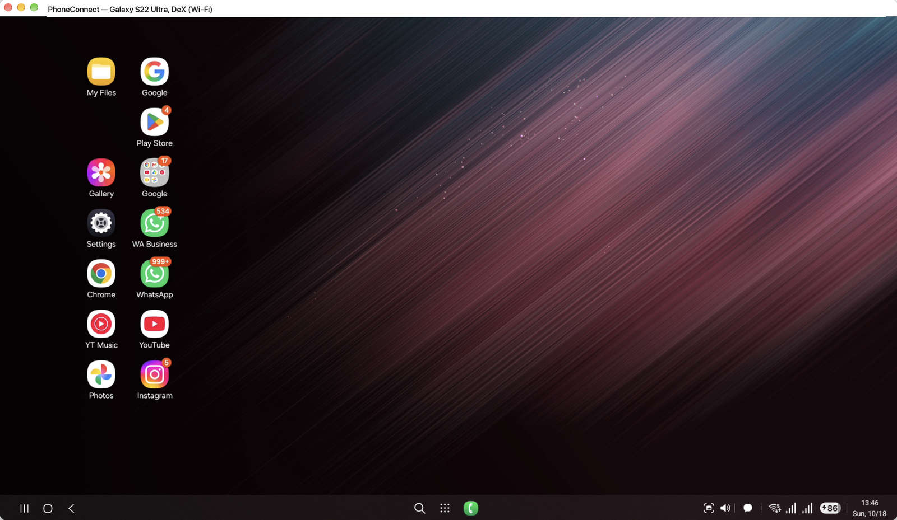
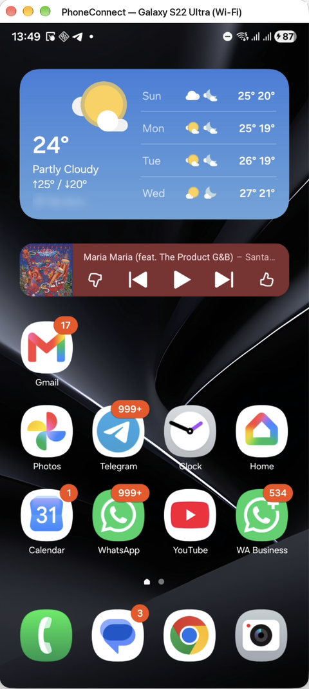

<p align="center"></p>

# PhoneConnect

**scrcpy in one click, for Mac and Windows.** No terminal, nothing else to install.

[](https://paypal.me/jzviagin)

Use your Android phone from your Mac or Windows PC: see its screen in a window, control it with your mouse and keyboard, dial calls without picking it up, and hear its sound on the computer. It also mirrors **Samsung DeX** as a desktop in a window.

PhoneConnect is a ready-to-use app around [scrcpy](https://github.com/Genymobile/scrcpy), the open-source Android screen mirroring tool. scrcpy is great but runs from the command line; PhoneConnect gives you an app you just open:

- **Everything included:** scrcpy and adb ship inside the app. No Homebrew, no Android SDK, no PATH setup.
- **Finds your phone by itself:** USB first, then Ethernet (a USB-C dock), then Wi-Fi, and it remembers the phone, so after one cable connection it works wirelessly.
- **Several phones:** asks which one to connect to, and keeps track of each phone's addresses.
- **Samsung DeX:** mirrors the DeX desktop in a window, even with no monitor attached (with an HDMI dummy plug).
- **Real keyboard:** typing uses the phone's own keyboard layouts, so other languages work.
- **Shows what it's doing** in a small window while it connects, and retries by itself if the picture doesn't come up.

<p align="center">
  
  
</p>

## Download

The newest version is on the [Releases page](../../releases/latest). Older versions stay available there too.

| Computer | Download |
|---|---|
| Mac, installer (Apple Silicon and Intel) | [PhoneConnect.dmg](../../releases/latest/download/PhoneConnect.dmg) |
| Mac, plain zip (same app) | [PhoneConnect-macOS.zip](../../releases/latest/download/PhoneConnect-macOS.zip) |
| Windows, installer (Intel/AMD and ARM) | [PhoneConnect-Setup.exe](../../releases/latest/download/PhoneConnect-Setup.exe) |
| Windows, no install, Intel/AMD | [PhoneConnect-Windows-x64-portable.zip](../../releases/latest/download/PhoneConnect-Windows-x64-portable.zip) |
| Windows, no install, ARM (e.g. Parallels on an Apple Silicon Mac) | [PhoneConnect-Windows-arm64-portable.zip](../../releases/latest/download/PhoneConnect-Windows-arm64-portable.zip) |

## Install

**Mac**
1. Open **PhoneConnect.dmg** and drag **PhoneConnect** onto the **Applications** folder in the window that appears.
2. Open PhoneConnect from Launchpad or Applications. The first time, macOS blocks it because it isn't from a registered Apple developer. Go to **System Settings → Privacy & Security**, scroll down to the message about PhoneConnect, and click **Open Anyway**. You only need to do this once.

**Windows**
1. Run **PhoneConnect-Setup.exe**. No admin rights are needed.
2. If Windows shows **"Windows protected your PC"**, click **More info → Run anyway**. The app isn't signed with a paid certificate, so this appears once.
3. Start PhoneConnect from the Start menu or the desktop shortcut.

## Phone setup (once)

1. On the phone, go to **Settings → About phone → Software information** and tap **Build number** 7 times to unlock Developer options.
2. In **Settings → Developer options**, turn on **USB debugging**.
3. Plug the phone into the computer with a USB cable and open PhoneConnect. On the phone, tap **Allow** on *"Allow USB debugging?"* and tick **Always allow from this computer**.

## How it works

When you open PhoneConnect:

1. **It finds the phone.** It tries a **USB** cable first, then **Ethernet** (a USB-C dock with a network port), then **Wi-Fi**. The window title shows which one it used, for example *PhoneConnect (Ethernet)*.
2. **If a DeX screen is connected**, it asks whether to mirror **DeX** or the **phone screen**.
3. **It asks about audio:** whether to play the phone's sound on the computer. While audio is on, the phone's own speaker is muted.
4. **The phone opens in a window.** If no picture arrives within 15 seconds, it restarts the connection by itself, up to 3 tries.

**Going cable-free.** Whenever the phone is plugged in, PhoneConnect switches on the phone's network mode and remembers its Wi-Fi and Ethernet addresses. After that you can unplug, and the next launches connect over the network. The phone forgets network mode when it **restarts**, so plug it in once after each restart.

**The Ethernet address** is learned automatically the first time you open PhoneConnect while the phone is in a dock with a network cable. From then on, it uses the wired connection whenever the phone is docked.

**DeX without a monitor.** DeX only starts when the phone thinks a screen is connected. A cheap **HDMI dummy plug** in the dock's HDMI port does the trick.

## Tips

- **Typing in other languages.** PhoneConnect makes your keyboard act as a real keyboard plugged into the phone, so the phone's own layouts work (Hebrew included). Switch language with the phone's shortcut, usually **Ctrl+Space** or **Shift+Space**. On a Mac, first turn off macOS's own Ctrl+Space shortcut: **System Settings → Keyboard → Keyboard Shortcuts → Input Sources**.
- **Mouse and keyboard shortcuts in the window:** right-click is **Back**, middle-click is **Home**. On a Mac, Cmd+B is Back, Cmd+H is Home and Cmd+S is recent apps. On Windows, the same shortcuts use Alt.
- **Lock screen.** Android blacks out the lock screen in any mirror, so you can't see the pattern. Unlock on the phone itself, or use **Settings → Lock screen → Extend Unlock** (trusted places or devices).
- **Calls.** You can dial and answer from the window, but call audio stays on the phone or its Bluetooth earbuds. Android doesn't let screen mirroring carry call audio.

## Troubleshooting

| Problem | What to do |
|---|---|
| "No phone found" | Plug in the USB cable once (always needed after the phone restarts). Check that USB debugging is on and that you tapped **Allow** on the phone. |
| Choppy picture | Use a cable or Ethernet rather than Wi-Fi. On the phone, set **Display → Motion smoothness** to **Standard**. |
| It keeps retrying | Make sure the computer and phone are on the same network and no VPN is running. |
| Anything else | Look at the log of the last run: Mac `/tmp/PhoneConnect.log`, Windows `%TEMP%\PhoneConnect.log` |

## Repository layout

```
app/PhoneConnect.sh          the app: one zsh script, the same on Mac and Windows
platform/macos/, windows/    everything that differs per OS (dialogs, paths, starting scrcpy...),
                             same script names on both; packaged next to the app script
windows/Launcher.cs          PhoneConnect.exe: starts the script with the bundled zsh, icon, no console
tests/                       logic tests with a fake adb and scrcpy (run on both OSes in CI)
windows/installer.iss        Inno Setup script for PhoneConnect-Setup.exe
assets/                      icon (PNG, .icns, .ico), installer background, and the scripts that draw them
VERSION                      the first version, used until the first release tag exists
build/next-version.sh        works out the next version (x.y.z) from the tags
build/release-wanted.sh      decides whether a change on main is released or only built
build/versions.env           pinned scrcpy version, MSYS2 packages (the Windows shell) and checksums
build/build-macos.sh         builds the Mac release files, or a developer build with --dev
build/dmg-settings.py        layout of the .dmg installer window
build/build-windows.ps1      builds the Windows release files, or a developer build with -Dev
.github/workflows/build.yml  builds every pull request; on main, tags and releases each version
.github/workflows/version-preview.yml  comments on each pull request which version it will release
.github/pull_request_template.md       the pull request form, with the release and version boxes
.github/rulesets/main.json   rule that blocks merging into main unless both builds pass
```

## Building

The builds download the official scrcpy release (which includes adb) and check it against the pinned checksums. Everything ends up in `dist/`.

### Developer builds (to test a change)

These build only the app, with no installer, `.dmg` or zip, so they're quick to make and run straight from the folder. The version shows it's a developer build, for example **1.0.4-dev+3f2a1b9**: the next version, then the commit it was built from, plus `.changed` if you have changes you haven't committed yet. You'll see it in the dialog titles and the log.

**Mac** (in Terminal, in the repo folder):
```
./build/build-macos.sh --dev --run
```
This builds `dist/dev/PhoneConnect.app` and starts it, closing a running copy first. Leave out `--run` to only build. It doesn't touch the PhoneConnect you installed in Applications.

**Windows** (in PowerShell, in the repo folder):
```
powershell -ExecutionPolicy Bypass -File build\build-windows.ps1 -Dev -Run
```
This builds a ready-to-run folder `dist\dev\PhoneConnect\` for this PC (Intel/AMD or ARM) and starts it. It needs nothing installed, not even Inno Setup: scrcpy, the bundled shell and the tools to unpack it are downloaded by the build.

**Builds from GitHub.** Every pull request, and every change on `main` that isn't released, is also built on GitHub. To download the files, open the run under **Actions** and scroll to **Artifacts**.

### Release builds

GitHub makes these automatically (see below). To make one yourself:

**Mac**, giving the `.dmg` and the zip (the `.dmg` needs a Mac; on Linux you get only the zip):
```
APP_VERSION=1.2.3 ./build/build-macos.sh
```

**Windows**, giving the installer and the portable zips (needs [Inno Setup 6](https://jrsoftware.org/isdl.php); add `-SkipInstaller` to build only the zips):
```
$env:APP_VERSION = "1.2.3"
powershell -ExecutionPolicy Bypass -File build\build-windows.ps1
```

## Versions and releases

Versions look like **x.y.z**, for example 1.4.2. Every release is tagged `vX.Y.Z` and kept on the [Releases page](../../releases), which is the full version history, with the list of changes in each one.

**How a change gets released:**
1. **Open a pull request into `main`.** GitHub builds the Mac and Windows apps for it. If either build fails, the pull request can't be merged (once the rule below is on).
2. **Choose the version in the pull request form.** By default the **last** number goes up (1.2.3 → 1.2.4). To bump the **middle** number (1.3.0) or the **first** number (2.0.0) instead, tick the matching box under *Version*. A comment on the pull request always shows which version merging it will create, and it updates when you change the boxes.
3. **Merge it.** GitHub works out the version, builds it, tags the commit `vX.Y.Z` and publishes the release. The tag is only created once both builds succeed.

**Landing a change without releasing it.** Tick **Don't release this change** at the top of the pull request form, or add the label `no-release`. When you merge, `main` is updated and built, but no version is made. The change is included in the next release. For a direct push, put `[no release]` in the commit message.

**Pushing straight to `main`.** As the repository's owner, you can still push directly. The rule below lets admins skip the pull request. Your push is built and released like a merged pull request, unless the commit message says `[no release]`. Choose the version the same way, with `[minor]` or `[major]`. Pushes go out without the pull request build check, though, so use a pull request when you want the check first.

Instead of ticking a version box, you can add the label `release:minor` or `release:major` to the pull request. To make a release by hand, use **Actions → Build → Run workflow** and choose which number to bump.

The version is built into everything:
- **Mac:** the app's version in Finder's *Get Info*, the dialog titles, the log, and the installer window's name.
- **Windows:** the `.exe` and installer details (*Properties → Details*), *Apps & features*, the dialog titles and the log.

The download links at the top always point to the newest release.

**Turning on the merge check (once).** GitHub only enforces this if you add the rule. Go to **Settings → Rules → Rulesets → New ruleset → Import a ruleset** and choose `.github/rulesets/main.json`. The rule makes every change go through a pull request whose **Build macOS** and **Build Windows** checks pass, while still letting the repository's admins (you) push straight to `main`. With the [GitHub CLI](https://cli.github.com), you can do it in one line instead:
```
gh api -X POST repos/OWNER/PhoneConnect/rulesets --input .github/rulesets/main.json
```
On a free GitHub account, rulesets work on public repositories. A private repository needs GitHub Pro.

**First version.** Until the first release exists, the first version is taken from the `VERSION` file (`1.0.0`).

**Updating scrcpy.** Change the version and the four checksums in `build/versions.env`. The checksums are listed in `SHA256SUMS.txt` on the scrcpy release page.

## Support

PhoneConnect is free. If it's useful to you, you can support its development with a donation via [PayPal](https://paypal.me/jzviagin). Thank you!

## License

PhoneConnect's own files are under the [MIT License](LICENSE). The bundled software (scrcpy, adb, and on Windows the shell the app runs on) keeps its own licenses: see [THIRD_PARTY_NOTICES.md](THIRD_PARTY_NOTICES.md). The full license texts ship with the app in its `licenses` folder, and the exact source code of all bundled software is published in the [third-party sources release](../../releases/tag/third-party-sources-1).

PhoneConnect is an independent project, not affiliated with or endorsed by Genymobile (scrcpy), Google or Samsung.
